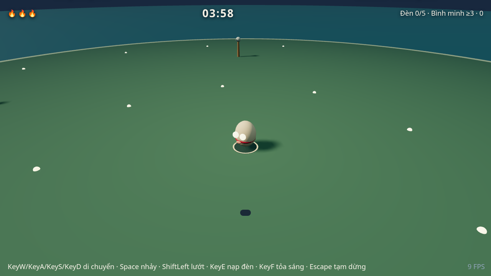

# Đảo Đèn Lồng — v1.0.0: Bình minh

[Xem video demo (.mp4)](docs/demo/demo.mp4) · [Truy vết yêu cầu và bằng chứng](docs/proof/traceability.md)

Game 3D góc nhìn thứ ba với ba đêm: Đảo Bến, Đảo Cau và Đảo Chuông. Mây nhặt đom đóm, thắp/châm dầu đèn, lướt và tỏa sáng để giữ ít nhất 60% đèn sáng tới bình minh, vượt qua Bóng Mực cùng Gió Lạc.

## Chạy game

```bash
npm ci
npm start
```

Mở http://localhost:4173 trong Chromium/Chrome có WebGL; Node.js 20+ được hỗ trợ. Chạy từ clone sạch cần hai lệnh trên. Bản phát hành đóng gói chạy từ thư mục `dist/` bằng `node server.js` (không cần cài package); bảng điểm lưu ở `leaderboard.local.json` cạnh nơi chạy lệnh, đừng mở HTML trực tiếp bằng `file://`.

 — xem bằng chứng trình duyệt và các kiểm tra chưa thực hiện tại `tests/browser-smoke.md`.

## Điều khiển
- Mặc định: WASD di chuyển · Space nhảy · Shift lướt · E nạp đom đóm · F tỏa sáng · Esc tạm dừng. Có thể đổi 9 phím, hoàn nguyên, tăng cỡ chữ và chọn bảng màu trong Cài đặt; HUD hiển thị các phím đang gán.

## Điểm
- Điểm được cộng khi nạp đom đóm, thắp đèn, trúng pulse và thắng đêm; tổng điểm giữ qua các đêm thắng.
- Chỉ lưu tổng điểm các đêm thắng sau khi thua hoặc hoàn tất Đêm 3. Bảng xếp hạng lưu tối đa 10 bản ghi trên máy đang chạy server, xếp theo điểm rồi thời gian. Xuất cùng dữ liệu bằng `npm start -- --export-leaderboard scores.json` (bản đóng gói: `node server.js --export-leaderboard scores.json`).

## Test Contract v1.3

```bash
node src/headless.js --seed 1 --night 1 --ticks 600 --out /tmp/game.jsonl
npm test
npm run verify
npm run benchmark
xvfb-run -a node scripts/bench-web.js --seed 42 --duration 30 --out bench.json
node scripts/soak.js --seed 7 --nights 10 --out soak.json
npm run build
node scripts/archive.js /tmp/dao-den-long-v1.0.0.zip
```

Tuning/map nằm trong `game.contract.json` và `src/maps.js`. Mô phỏng chạy 60 tick/giây, seed + scenario + inputs giống nhau cho JSONL giống hệt nhau. `--night` nhận 1, 2 hoặc 3; snapshots mặc định mỗi 10 tick. Pause giữ `sim_tick` và thời gian mô phỏng. Contract v1.3 thêm lệnh đo web và soak nhưng giữ nguyên nội dung JSONL v1.2. `npm run benchmark` **chỉ đo mô phỏng**; lệnh `bench-web.js` mới đo Three.js trong Chromium thật, cần tải browser bằng `npx playwright install chromium` sau `npm ci` nếu máy chưa có. Mặc định yêu cầu cửa sổ Chromium ở viewport 1280×720; trên Linux không có display dùng `xvfb-run -a` như trên. `BENCH_HEADLESS=1` chỉ để chẩn đoán, **không** thay kết quả benchmark windowed. Đo ba giây warmup rồi lấy mẫu 30 giây, 1% low dùng các delta chậm nhất và p95 dùng nearest-rank. Browser/compositor có thể áp vsync; `vsync_off:false` không chứng minh đã vô hiệu hóa. Browser RSS không có API portable nên `peak_mem_mb:null`, **không** thay bằng Node RSS. Soak 10 đêm seed 7–16 theo thứ tự Night 1→2→3 lặp lại, báo RSS của chính process Node. Số liệu thực tại `bench.json`/`soak.json` phụ thuộc môi trường, không là cam kết ngưỡng phần cứng.

## Số liệu chuẩn

Tốc độ chạy 6 m/s, lướt 14 m/s trong 0.2 s; sức chứa ban đầu 10, tăng hai sau mỗi lần thắp thành công tới tối đa 20. Đèn chưa từng sáng cần 10 đom đóm, đèn từng sáng cần 5 để thắp lại; đèn đang sáng hao 1 dầu/s, châm dầu +10/đom đóm, Bóng Mực có thể hút 5 dầu/s khi đèn yếu. Đêm 1/2/3 kéo dài 240/270/300 giây. Toàn bộ tuning v1.2 xem trong `game.contract.json`.

## Sáng tạo của tôi

Tạo hình nhân vật và hiệu ứng ánh sáng thủ tục theo bảng màu chuẩn; âm thanh tổng hợp chạy ở browser. Renderer/audio/settings không thay đổi kết quả headless.

## Bằng chứng và ghi chép

Các tag `phase-1` đến `phase-4` là **bản tái dựng sau buổi lab** từ snapshot OpenCode (contract lần lượt v1.0 đến v1.3), không phải chứng cứ hoàn thành đúng hạn. Bản phát hành trước tái dựng vẫn có tại nhánh `archive/pre-reconstruction-v1.0.0`.

- Kiểm tra Phase 1: `docs/proof/phase-1.md`
- Truy vết các phase, trạng thái kiểm chứng và giới hạn nộp bài: `docs/proof/traceability.md`.
- Acceptance criteria Ticket-02: `docs/superpowers/specs/2026-11-20-ticket-02-three-islands.md`
- Thiết kế Ticket-03: `docs/superpowers/specs/2026-11-20-ticket-03-oil-lanterns-design.md`; quyết định dầu/thắng: `docs/adr/2026-11-20-oil-lanterns-and-dawn.md`; breaking changes: `CHANGELOG.md`.
- Checklist browser: `tests/browser-smoke.md`
- Nguồn và giấy phép: `CREDITS.md`, `LICENSE`.
